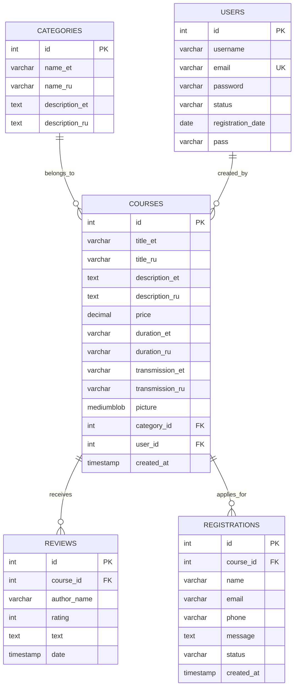

# TARKVARA NÕUETE SPETSIFIKATSIOON (SRS)
## Standard: ISO/IEC/IEEE 29148:2018
### Projekt: DrivePro Autokooli Veebisüsteem (Autokool Web Portal)

---

## 1. Sissejuhatus (Introduction)

### 1.1 Dokumendi eesmärk (Purpose)
Käesolev spetsifikatsioon kirjeldab autokooli "DrivePro" veebiportaali funktsionaalseid ja mittefunktsionaalseid nõudeid vastavalt rahvusvahelisele tarkvaranõuete spetsifitseerimise standardile **ISO/IEC/IEEE 29148:2018**. Dokument on aluseks tarkvara arendusele, testimisele, kvaliteedikontrollile ja vastuvõtmisele.

### 1.2 Süsteemi ulatus (Scope)
Süsteem kujutab endast kaasaegset PHP MVC veebirakendust kaupade ja teenuste pakkumiseks autokooli valdkonnas. Süsteem võimaldab:
- Tutvuda juhilubade kategooriate (A, B, C) ja täiendkoolitustega (lõppaste, esmaabi).
- Kasutada interaktiivset hinnakalkulaatorit personaalse koolituspaketi hinna ja osamaksete arvutamiseks.
- Registreeruda kursustele mugava modaalvormi abil.
- Lugeda ja lisada õpilaste tagasisidet (tärnihinnangud ja kommentaarid).
- Hallata kursusi ja vaadata laekunud avaldusi kaitstud administraatori juhtpaneelis.

### 1.3 Mõisted ja lühendid (Definitions and Acronyms)
- **MVC (Model-View-Controller):** Tarkvara arhitektuurimuster, mis eraldab andmemudeli, kasutajaliidese ja juhtimisloogika.
- **SRS:** Software Requirements Specification (Tarkvara nõuete spetsifikatsioon).
- **CRUD:** Create, Read, Update, Delete (Loomine, lugemine, muutmine, kustutamine).
- **Transpordiamet:** Eesti Vabariigi transpordi ja juhilubade riiklik reguleeriv asutus.

---

## 2. Üldkirjeldus (Overall Description)

### 2.1 Toote perspektiiv ja arhitektuur
Süsteem töötab veebipõhisena ja tugineb järgmisele tehnoloogilisele virnale (LAMP/WAMP):
- **Server:** Apache 2.4+ (mod_rewrite lubatud marsruutimiseks)
- **Keeled:** PHP 8.0+ (objektorienteeritud MVC struktuur, PDO)
- **Andmebaas:** MySQL 5.7+ / MariaDB 10.4+ (utf8mb4 kodeering)
- **Kasutajaliides:** HTML5, CSS3 (Bootstrap 4.5+ ja kohandatud CSS), JavaScript (jQuery, DOM manipulatsioonid)

### 2.2 Kasutajagrupid ja rollid (User Classes and Characteristics)
1. **Anonüümne Külastaja (Potentsiaalne õpilane):**
   - Sirvib kursusi, kategooriaid ja arvustusi.
   - Kasutab interaktiivset hinnakalkulaatorit.
   - Registreerub kursustele ja esitab tagasisidet.
2. **Registreeritud Õpilane (Koolitatav):**
   - Omab ligipääsu õppeinfole ja registreeritud andmetele.
3. **Administraator / Sõiduõpetaja:**
   - Logib sisse administraatori liidesesse (`/admin`).
   - Teostab kursuste CRUD toiminguid (lisab uusi kursusi, muudab hindu ja kirjeldusi, laadib üles pilte, kustutab).
   - Vaatab veebilehelt saabunud registreerumisavaldusi.

---

## 3. Funktsionaalsed Nõuded (Functional Requirements)

| ID | Funktsiooni Nimetus | Kirjeldus ja Tingimused | Prioriteet |
| :--- | :--- | :--- | :--- |
| **FR-01** | Kursuste kataloog ja esileht | Süsteem kuvab esilehel populaarsemaid koolitusi ning täisnimekirjas kõiki pakutavaid kursusi koos pildi, hinna, kestuse ja kategooria märkega. | Kõrge |
| **FR-02** | Kategooriate filter | Kasutaja saab filtreerida kursusi kategooriate kaupa (A, B, C, Lisakoolitused) nii navigeerimismenüüst kui nupuribalt. | Kõrge |
| **FR-03** | Reaalajas otsing | Kasutaja saab otsida kursusi märksõna järgi reaalajas ilma lehe taaslaadimiseta (live filter) või otsinguvormi kaudu. | Keskmine |
| **FR-04** | Kursuse detailvaade | Süsteem kuvab valitud kursuse täieliku kirjelduse, koolituse hinna sisu, osamaksete kalkulatsiooni ja õpilaste arvustused. | Kõrge |
| **FR-05** | Interaktiivne Hinnakalkulaator | Dünaamiline JS-tööriist: baashinna, käigukasti tüübi, lisatundide arvu ja lisamoodulite (esmaabi, libedasõit) interaktiivne arvutamine. | Kõrge |
| **FR-06** | Kiire registreerumine | Kasutaja saab avada mis tahes kursuse juurest hüpikakna (modal) ja saata registreerumistaotluse nime, telefoni, e-posti ja lisasoovidega. | Kõrge |
| **FR-07** | Arvustuste ja tärnide süsteem | Kursuse detaillehel saab lisada nime, tärnihinnangu (1-5) ja tekstilise tagasiside, mis kuvatakse koheselt kursuse juures. | Keskmine |
| **FR-08** | Kasutajate registreerimine | Kasutaja saab registreerida portaali konto nime, unikaalse e-posti ja parooliga (parool hashitakse turvaliselt `password_hash`). | Keskmine |
| **FR-09** | Administraatori autentimine | Kaitstud sisselogimine administraatori paneeli (`/admin`) kontrollides rolli ja seansi kehtivust (`$_SESSION`). | Kõrge |
| **FR-10** | Kursuste CRUD haldus | Administraator saab lisada uusi kursusi, muuta olemasolevaid (sh pilte ja tekste) ning kustutada ebavajalikke kursusi. | Kõrge |
| **FR-11** | Laekunud avalduste nimekiri | Administraator saab vaadata kõiki veebilehelt saabunud registreerumisavaldusi kontaktandmete ja sooviavaldustega. | Kõrge |
| **FR-12** | Kakskeelsuse tugi (ET / RU) | Veebileht toetab täielikult eesti ja vene keelt; päises asuv lüliti võimaldab keelt vahetada reaalajas ilma vaatelt lahkumata. | Kõrge |

---

## 4. Mittefunktsionaalsed Nõuded (Non-Functional Requirements)

### 4.1 Kohanduvus ja seadmetugi (Usability & Responsiveness)
- **NFR-01 (Responsive Design):** Süsteem peab kohanduma automaatselt ekraanisuurustega alates nutitelefonidest (320px) kuni suurte lauaarvuti monitorideni (1920px+).
- **NFR-02 (Accessibility):** Selged kontrastid, loetavad tüpograafiafondid (Montserrat pealkirjades, Open Sans põhitekstis).
- **NFR-03 (Dynamic Effects):** Kaartide sujuv hõljumisefekt (`hover lift`), animatsioonid modaalakendel ja kalkulaatori reaalajas numbrimuutus.

### 4.2 Jõudlus ja Töökindlus (Performance & Reliability)
- **NFR-04:** Lehekülje esmane laadimisaeg lokaalses võrgus < 0.5 sekundit.
- **NFR-05:** Andmebaasipäringud peavad olema optimeeritud indeksitega primaar- ja välisvõtmetel.

### 4.3 Turvalisus (Security)
- **NFR-06:** Kasutaja paroolid salvestatakse tugeva soolatud räsi kujul (`PASSWORD_DEFAULT` / BCRYPT).
- **NFR-07:** Sisestusväljad puhastatakse (`strip_tags`, `addslashes`, parameetrilised päringud), et ennetada SQL-süstimist (SQL Injection) ja XSS ründeid.
- **NFR-08:** Administraatori alale on ligipääs lubatud ainult autenditud seanssidele.

---

## 5. Andmebaasi Arhitektuur (Database Schema & ERD)

Andmebaasi nimi: **`autokool`** (täielikult eraldatud ja puhastatud NewsPortali jäänustest).

### 5.1 Olemidiagramm (Mermaid ERD)

---

## 6. Kasutuslood (Use Cases)

### UC-01: Õpilane registreerub kursusele läbi kalkulaatori
1. Kasutaja navigeerib lehele "Hinnakalkulaator".
2. Kasutaja valib B-kategooria, automaatkäigukasti ja 4 lisasõidutundi.
3. Süsteem arvutab koheselt koguhinna ja osamakse.
4. Kasutaja vajutab "Registreeru selle paketiga".
5. Avaneb eeltäidetud modaalaken; kasutaja sisestab nime, telefoni ja e-posti ning vajutab "Kinnita".
6. Andmed salvestatakse tabelisse `registrations` ja kasutajale kuvatakse kinnitus.

### UC-02: Administraator lisab uue koolituse
1. Administraator logib sisse aadressil `/admin`.
2. Valib menüüst "Lisa kursus".
3. Täidab väljad: nimetus, hind, kestus, käigukast, kirjeldus ja laadib üles pildi.
4. Vajutab "Salvesta".
5. Kursus ilmub koheselt avalikule veebilehele ja administraatori nimekirja.
